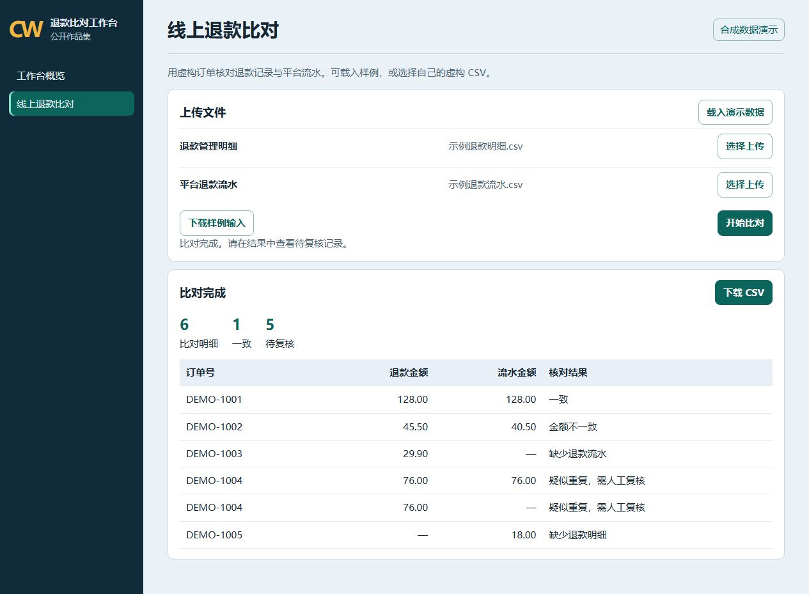

# 退款比对工作台

面向财务对账人员，将 ERP 退款明细、平台流水和线下日记账的核对流程集中到一个入口。这个仓库是项目的公开作品集，附有可运行的合成数据演示。

## 试用演示

1. 点击仓库的 **Code → Download ZIP**，完整解压。
2. 双击 `index.html`，在浏览器打开。
3. 点击「载入演示数据」→「开始比对」→「下载 CSV」。也可以下载样例输入，再通过两个上传入口重新运行。

演示在浏览器本地运行，无需安装软件或联网。请只使用虚构数据。正式工作台使用 Excel 并提供更多业务模块，演示版用 CSV 展示线上比对的主流程。

## 项目设计

- **减少人工重复操作。** 将 ERP 合并拆分、线上和线下退款比对、结果核查和退预收比对集中到一个工作台，统一文件选择、缺项提示和结果下载，减少在不同工具间切换和重复整理表格。
- **清洗和整理多平台退款数据。** 将各平台退款明细、流水及 ERP 数据中的订单号、退款时间和金额等关键字段统一整理，为后续比对提供一致的数据口径。
- **减少约 50% 的人工差异核对工作量。** 按业务规则自动完成可判定的核对，并标记流水缺失、金额差异和疑似重复等情况，保留需要结合业务背景判断的记录，由财务人员复核。
- **建立规则库与结果追溯流程。** 集中管理各业务模块的比对规则，记录每次运行的输入文件校验信息、启用的规则版本和运行编号，让财务人员能从导出结果追溯到当时使用的输入和规则。

## 我的参与

全程参与从财务需求梳理、业务口径确认和人工复核流程设计，到原型设计、界面迭代、功能开发、回归验收和 Windows 免安装交付。使用 Codex 和 ImageGen 辅助设计与开发，退款比对由业务规则执行。验收时回放 3,025 条 ERP 退款明细，将六张业务表与历史导出逐格对照，结果一致。

公开仓库包含独立演示代码、虚构数据和项目说明。正式系统的业务规则、内部名单、原始 Excel、运行记录及提交历史均留在原项目中。
